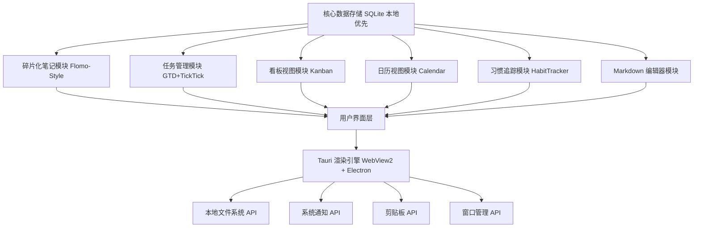

# 待办应用 - 产品功能架构图

## 🏗️ 整体架构



---

## 📦 功能模块详解

### 1️⃣ 核心存储层 (Core Storage Layer)

#### 数据模型

**主表结构**: `todos`
| 字段 | 类型 | 说明 |
|------|------|------|
| id | UUID v4 | 唯一标识 |
| title | TEXT(256) | 任务标题 |
| description | TEXT | 详细描述 |
| category | ENUM | 工作/个人/学习/开会 |
| priority | ENUM | high/medium/low |
| due_date | DATETIME | 截止时间 |
| completed | BOOLEAN | 完成状态 |
| fragment_id | UUID | 关联碎片化笔记 ID |
| markdown_content | TEXT | Markdown 格式内容 |
| tags | JSONARRAY | 标签数组 |
| subtasks | JSONARRAY | 子任务列表 |
| created_at | DATETIME | 创建时间 |
| updated_at | DATETIME | 最后更新时间 |

**笔记表**: `fragments`
- 存储碎片化记录（想法、灵感、临时待办）
- 支持 Markdown 格式
- 自动关联到任务或独立存在

### 2️⃣ 核心功能模块 (Core Modules)

#### 📝 2.1 碎片化内容记载 (Flomo-Lite)

**定位**: 捕捉灵感/临时想法的"便签模式"

**特性**:
- ✅ 快速输入区（Ctrl+N / Cmd+N）
- ✅ 时间轴视图（按日期分组）
- ✅ @关键词关联任务
- ✅ 一键转为正式待办
- ✅ 自动标签提取

**交互设计**:
```
┌─────────────────────────┐
│ [10:23] 准备下午会议资料   │ @工作
│ ─────────────────────── │
│ [09:45] 购买咖啡          │ #待办
│ @个人                    │ → 转为任务
│ ─────────────────────── │
│ [昨天] 阅读《深入理解 JVM》│ @学习
└─────────────────────────┘
```

#### ✅ 2.2 任务管理 (GTD+TickTick)

**待办列表**:
- 按优先级排序（高/中/低）
- 拖拽重排行 → 改变排序规则
- 完成动画效果
- 子任务嵌套

**智能提醒**:
- ⏰ 系统通知推送（Tauri Notify）
- 📅 重复任务设置（每天/每周/自定义周期）
- 🔔 临近截止提前 N 分钟提醒
- 🎯 基于上下文智能推荐（"今天你有 2 个工作待办"）

#### 📋 2.3 看板视图 (Kanban)

**列配置**: 支持用户自定义列名
```
┌───────────────────────────────────────┐
│ [待处理]   [进行中]   [等待审核]   [已完成] │
│ ──────────────────────────────────────│
│ 📌 准备汇报文档           ⚡          │
│ 📌 联系客户确认需求        │          │
│ 📌 更新项目进度         ✅          │
└───────────────────────────────────────┘
```

#### 📅 2.4 日历视图 (Calendar)

**模式**:
- 🗓️ 月视图（按周滚动）
- 🔍 日视图（时间轴详细）
- ✨ 事件聚合（多个任务在同一天显示）

#### 🔄 2.5 习惯追踪 (Habit Tracker)

**统计维度**:
- 连续天数挑战徽章系统
- 周/月完成趋势图
- 习惯模板预设（阅读、运动、冥想...）

---

### 3️⃣ 辅助功能模块 (Auxiliary Modules)

#### 📄 Markdown 编辑器

**特性**:
- ⌨️ Ctrl/Cmd+B I U 快捷键
- 🖼️ 代码块高亮 + Markdown 预览
- 🔗 @引用其他笔记/任务
- 📊 统计图表（任务词云、完成情况饼图）

#### 💾 导出与同步 (Export & Sync)

**本地导出**:
- 🔽 JSON 完整备份
- 🔽 Markdown 笔记导出
- 🔽 PDF 打印版报告

**云端同步**（可选）:
- 🌐 WebDAV（Nextcloud/Synology）
- ☁️ Dropbox / OneDrive （增量同步）
- 🔒 用户密钥加密传输

#### 🖼️ 界面配置 (Customization)

**主题系统**:
- 🎨 Light/Dark 自动切换
- 🌈 15+ 预设配色方案
- 🖌️ 自定义 CSS 变量注入

---

## 🔧 技术实现栈

### 前端
```json
{
  "framework": "Vue 3 Composition API",
  "ui_library": "Naive UI",
  "storage": "SQLite (via tauri-plugin-sql)",
  "window_manager": "Tauri Window APIs"
}
```

### 后端（可选）
```
架构模式：
└── Serverless Options:
    ├── Webhooks (自建 HTTP 服务)
    └── Background Jobs (Tauri 命令行任务处理)
```

---

## 📊 功能优先级矩阵

| 模块 | MVP 版本 | Phase 2 | Phase 3 |
|------|----------|----------|----------|
| 任务管理 | ✅核心 | ✅子任务/嵌套 | 🔄递归任务 |
| 碎片化笔记 | ✅QuickAdd | ✅@关联 | 🤖AI 标签提取 |
| 看板视图 | ⚠️简化版 | ✅拖拽排序 | 🎯自定义列规则引擎 |
| 日历视图 | ⚠️基础展示 | ✅月/日模式切换 | 🔔事件聚合 |
| 习惯追踪 | ❌ | ✅连续统计徽章 | 🏆挑战排行榜 |
| Markdown | ✅轻量预览 | ✅代码高亮 | 🖼️图表生成 |
| 导出同步 | ✅JSON 导出 | ✅WebDAV | ☁️云服务商集成 |
| 主题配置 | ✅深色模式 | 🎨10+ 预设主题 | 🛠️CSS 插件系统 |

---

## 📐 技术决策文档 (ADR)

### ADR-001: 本地优先数据架构
**问题**: 用户期望随时可用，不依赖网络  
**方案**: SQLite + 可选 WebDAV/云同步  
**权衡**: 
- ✅零延迟、离线可用
- ⚠️数据迁移复杂性
- ✅用户完全掌控

### ADR-002: Markdown 作为核心格式
**问题**: 如何选择任务描述存储格式？  
**方案**: UTF-8 无限制文本（实际支持 Markdown）  
**理由**: 兼容性最佳、可自定义渲染器

### ADR-003: 碎片化笔记定位
**问题**: 如何平衡"随手记"与"正式待办"？  
**方案**: @关键词自动关联 + 一键转换机制
