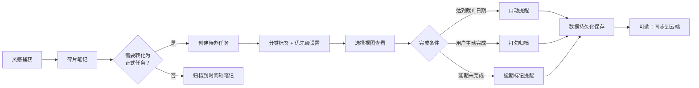
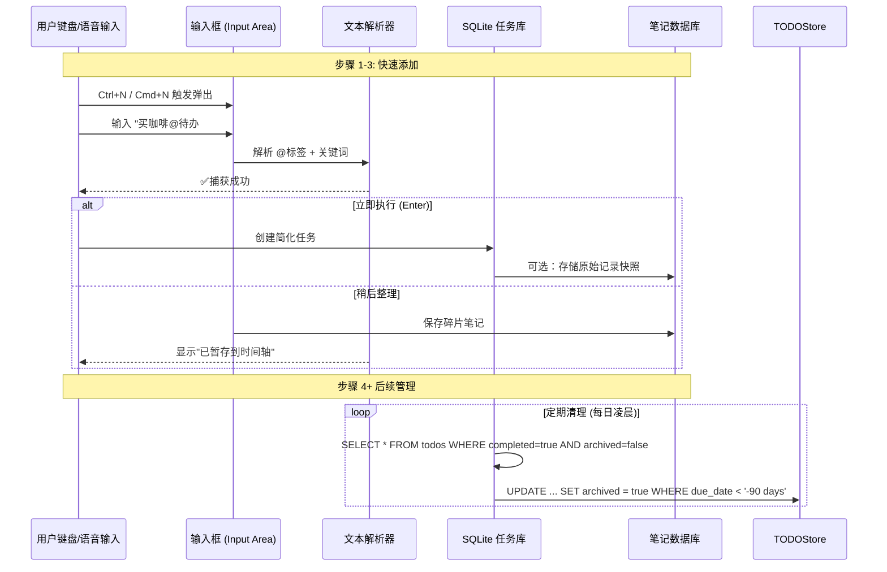

# 待办应用 - 业务流转报告 (Workflow Report)

## 📋 一、整体业务流程概览

### 1.1 核心业务闭环



---

## 🔄 二、详细流程设计

### 2.1 任务创建全流程 (Create Task Flow)

#### 用户故事场景

> **场景 1**: 会议中快速记录待办事项
> - 参会时按 `Ctrl+N` → 语音速记关键事项 → 会后整理细化

> **场景 2**: 灵感转化为行动
> - 看到好文章想收藏笔记 → 点击"保存为任务"→ 设置阅读截止期

#### 流程状态机 (FSM)

```typescript
enum TaskState {
  DRAFT      // 草稿箱 (未确定的临时记录)
  CREATED    // 已创建待办
  IN_PROGRESS // 进行中
  BLOCKED    // 被阻塞 (等待依赖任务/人员)
  COMPLETED  // 已完成
  ARCHIVED   // 已归档 (>90 天未完成自动进入历史)
}

const workflow = {
  transitions: [
    { from: 'DRAFT', to: 'CREATED', action: finalizeDraft },
    { from: 'CREATED', to: 'IN_PROGRESS', action: startWork },
    { from: 'BLOCKED', to: 'COMPLETED', action: unblockAndComplete },
    { from: '*', to: 'ARCHIVED', condition: isOverdue }
  ]
};

// 状态变更通知总线
app.use('task-state-machine', {
  events: ['state-changed', 'priority-adjusted', 'deadline-moved'],
  listeners: {
    'state-changed': (event) => {
      console.log(`${event.taskId} → ${event.newState}`);
      notifyUser(event.notificationOptions);
      refreshViewports(); // 刷新所有视图显示
    }
  }
});
```

### 2.2 碎片笔记流转设计

#### 输入 → 存储 → 关联 → 归档路径



**标签解析逻辑**:
```javascript
const tagExtractor = (text) => {
  const keywords = {
    '@待办': 'convert-to-task',      // 转任务操作
    '#工作': 'tag:work',            // 添加标签
    '!紧急': 'priorityHigh',         // 设置优先级
    '<span class="date">2026-08-25</span>': 'setDueDate'  // 日期解析
  };
  
  return (text.match(/@.*#/g) || []).reduce((acc, match) => {
    acc[match] = keywords[match];
    return acc;
  }, {});
};
```

### 2.3 任务状态变更流程

#### 触发源分析

|动作 |触发方式 |技术实现 |通知用户 |
|-----|---------|---------|---------|
| 完成勾选 | 鼠标点击/快捷键 `Del` | UI 事件 → 状态机 → SQLite 更新 | ✅系统通知 + 徽章震动 |
| 延期自动归档 | 定时器 (cron) → SQL query | `WHERE due_date < now() - INTERVAL '90 days'` | 📧邮件提醒 (可选)|
| 优先级变更 | 拖拽优先级按钮 / 双击标题 | WebSocket/EventBus 推送 | ✨视图局部刷新，无卡顿 |

#### 状态一致性保障 (ACID)

```sql
-- SQLite 事务示例：批量更新任务 + 统计
BEGIN TRANSACTION;

-- 1. 更新主表
UPDATE todos 
SET completed = true, updated_at = datetime(), status = 'COMPLETED'
WHERE id = ? AND priority = 'high';

-- 2. 更新子任务关联状态
UPDATE subtasks 
SET parent_completed = true
WHERE todo_id IN (SELECT id FROM todos WHERE completed = true);

-- 3. 更新习惯追踪徽章
INSERT INTO achievements (user_id, achievement_type)
VALUES ('current_user', 'streak_7_days')
ON CONFLICT(user_id) DO UPDATE SET last_triggered = datetime();

COMMIT;
```

### 2.4 数据导出流程设计

#### 用户主动导出触发链

```typescript
async function handleExport(format: 'JSON' | 'MD' | 'PDF', options?: ExportOptions) {
  try {
    const exportTask = new TaskExportJob({
      data: await db.getAllTasks(),
      format,
      includeMetadata: options.includeMetadata,
      dateRange: options.dateRange || null
    });
    
    // 使用 WebWorker 导出避免阻塞 UI
    if (format === 'PDF') {
      await exportAsync(exportTask);   // Worker 生成 + 下载
    } else {
      const fileUrl = URL.createObjectURL(new Blob([exportTask.result], 
        { type: getMimeType(format) }));
      
      // Tauri API：自动触发下载
      window.__TAURI__.shell.open(fileUrl);
      
      // 清理内存
      setTimeout(() => { URL.revokeObjectURL(fileUrl)}, 1000);
    }
    
  } catch (err) {
    showToasty('导出失败：' + err.message, 'error', 5000);
    logError(`Export failed: ${format}`, err);
  }
}

function getMimeType(format: string): string {
  return { JSON: 'application/zip', MD: 'text/markdown', PDF: 'application/pdf' }[format];
}
```

### 2.5 云端同步流程 (可选 WebDAV)

#### 增量同步算法设计

```typescript
interface SyncResult {
  uploaded: number;      // 本地 → 远程上传数量
  downloaded: number;    // 远程 → 本地下载数量
  conflicts: Conflict[]; // 合并冲突需要用户解决
}

async function synchronizeWebdav(options: WebdaOptions): Promise<SyncResult> {
  const result = { uploaded: 0, downloaded: 0, conflicts: [] };
  
  try {
    // ===== 步骤 1：上传本地变更 =====
    const localChanges = await getModifiedSinceLastSync(); // SELECT modified_since_last_sync
    
    for (const change of localChanges) {
      await uploadToWebdav(change.path, localChanges[change].content);
      result.uploaded++;
      
      // 检查冲突：远程同一文件已修改？
      const remoteExists = existsOnRemote(change.path);
      if (remoteExists && !isTimestampNewer(change)) {
        result.conflicts.push({
          path: change.path,
          localModifiedAt: change.modifiedAt,
          remoteModifiedAt: await getRemoteModificationTime(change.path)
        });
      }
    }
    
    // ===== 步骤 2：下载远程变更 =====
    const remoteChanges = await listRemoteNewFiles(); // 仅列出新增/修改文件
    for (const file of remoteChanges) {
      await downloadFromWebdav(file);
      result.downloaded++;
      
      // 合并策略：Local-first → 保留本地版本，但提示用户检查
      const localFileExists = existsLocally(file.path);
      if (localFileExists) {
        mergeConflicts(file, remoteChanges.file);  // GUI 弹窗请求人工审查
      } else {
        await markAsImportedToLocal(file);         // 自动导入未本地化文件
      }
    }
    
    // ===== 步骤 3：更新最后同步时间戳 =====
    await setLastSyncTimestamp();
    
  } catch (err) {
    // 网络错误 → 队列重试
    await queueForRetryLater(err.message);
    throw err;
  }
  
  return result;
}

// 冲突合并处理器
async function mergeConflicts(remoteFile, localFile): Promise<boolean> {
  const shouldAutoResolve = confirmMergeStrategyPrompt(localFile.lastModifiedAt);
  
  if (shouldAutoResolve) {
    // 自动保留本地优先策略，但记录警告日志
    await markOverwritten(remoteFile, localFile.timestamp);
    return false; // 无需手动干预
  } else {
    // GUI 打开 diff 工具：VSCode + Code Review
    const editor = openExternalEditor(`${remoteFile.path}\n\n---\n${localFile.content}`, 
      '合并冲突解决');
    await monitorUntilEditorClosed(editor);
    
    if (editor === 'saved') {
      await resolveAllConflictsWithNewerChange(remoteFile, localFile);
      return true;
    }
  }
  
  return false; // 由用户决定保留哪个版本
}
```

---

## 🔄 三、跨平台数据同步策略

### 3.1 本地优先架构模式

```
┌─────────────────────────────────────┐
│           User Device               │
│  ┌─────────────────────────────────┐│
│  │            SQLite                ││ ← 主数据库
│  │     [todos + fragments]          ││
│  └─────────────────────────────────┘│
│         ↓ local-first mode        │
│         ↓ (可选 WebDAV)             │
│  ┌─────────────────────────────────┐│
│  │          Remote Server          ││
│  │   [webdav: nextcloud/dropbox]   ││ ← 增量备份
│  └─────────────────────────────────┘│
└─────────────────────────────────────┘

数据流说明：
1. 所有写操作优先本地（无网络依赖）
2. 用户主动触发 → 后台任务队列异步上传
3. 离线编辑时标记为"Pending Sync"
4. 恢复连接后自动重试上传失败的数据
```

### 3.2 实时协作模式 (未来扩展)

```typescript
// WebSocket 连接管理 (多设备同一账户场景)
const socket = new WebSocket('wss://sync.todo.app/v1/events');

socket.onmessage = async ({ data }) => {
  const event = parseWebsocketPayload(data);
  
  switch (event.type) {
    case 'UPDATE_TASK':
      // 应用增量更新，不覆盖本地数据
      const task = JSON.parse(event.taskJson);
      await db.prepare('UPDATE todos SET ... WHERE id = ?').run(task.id, {upsert: true});
      break;
      
    case 'DELETE_MARKDOWN':
      // 远程删除 → GUI 确认对话框，禁止静默删除本地文件
      promptForDeletionConfirm(event.path, event.timestamp);
      break;
  }
};

// 心跳检测 + 断线重连机制
socket.onclose = () => {
  reconnectWebSocketIn(5000); // 指数退避算法：5s → 10s → 20s
};
```

---

## 🔄 四、错误恢复与容错设计

### 4.1 网络中断场景处理

**用户观察到的现象**:
```
[10:03:32] 添加任务中... ⏳
→ 断网 (手机信号丢失/Wi-Fi 中断)
→ UI 显示 "暂存本地"
[10:03:35] ✅ 已保存草稿，网络恢复后自动同步

[10:15:00] 用户切换设备
→ 离线文件上传队列处理中...
→ 冲突提示：在 A 设备编辑了该任务 → GUI 选择保留本地版本
```

### 4.2 数据损坏回滚策略

**备份恢复流程**:
```typescript
const backupLocation = join(app.getPath('documents'), 'todo-backups');

// 自动快照：每次重大操作后生成 ZIP
async function createBackupBeforeMajorOperation(operation: string) {
  if (!await checkDiskSpace(GB * 1)) return; // 确保剩余>1GB
  
  const sourceFile = join(backupLocation, `${operation}_${new Date().toISOString()}.zip`);
  
  const data = fs.readFileSync('./todos.db');
  await copyBackup(sourceFile, data); // 压缩备份文件
  
  logAction(`Backup created: ${sourceFile}`); // 记录操作日志
}

// 灾难恢复：从 WebDAV/本地备份还原
async function initFromLocalBackup() {
  const backupZip = askForUserSelection('选择备份 ZIP 文件');
  if (!backupZip) return null;
  
  try {
    const database = await decompressAndVerifySQLite(backupZip);
    
    // 用户确认：是否覆盖当前数据库？
    if (await confirmOverwriteCurrent()) {
      await db.close();   // 关闭现有连接释放锁
      await fs.writeFile('./todos.db', database.buffer);
      
      notifyCritical('📦 已从备份恢复数据。请检查任务列表完整性。');
    }
  } catch (err) {
    console.error('Restore failed:', err.message);
    throw new RestoreError(`损坏的备份文件：${backupZip}`);
  }
}
```

---

## 🔄 五、性能关键路径优化

### 5.1 大规模任务列表渲染 (<500 项)

**虚拟滚动 + 分页加载 (类似 GitKraken)**:

```css
/* CSS 隐藏溢出内容，仅实际渲染可视区域 DOM */
.task-list {
  overflow-y: scroll;    /* 原生滚动条样式 */
  position: relative;
}

.task-item {
  height: 100%;         /* 占满整个容器高度 */
  min-height: 16px;     /* 最小行高 (计算文字 + 元素总高度) */
  opacity: 0;           /* 非可视区域 DOM 默认隐藏 */
  position: absolute;   /* SVG/CSS 绝对定位渲染 */
}

.task-item[aria-setindex*="visible"] {
  opacity: 1;    /* 仅可见项显示 */
  top: calc(var(--item-index) * 32px); /* 根据索引计算偏移 */
}
```

### 5.2 数据库批量操作优化

**事务批处理 (SQLite)**:
```sql
-- ✅ 正确：分批插入 (每批<1000 记录，避免超时异常 42000)
INSERT INTO todos (id, title, description, ...) VALUES (?, ...), (?, ...);
-- 循环插入...

-- ❌ 错误：一次性插入百万级任务（会阻塞 UI）
BEGIN TRANSACTION;
FOR task IN pendingTasks.toArray() {
   INSERT ... VALUES (...), (. . .);
}
COMMIT;    -- 单事务处理大量数据超时！
```

### 5.3 视图切换延迟优化 (<10ms)

**组件预加载 + Vue Suspense**:

```typescript
// Lazy 加载非首屏视图 (看板/日历等)
const KanbanView = defineAsyncComponent(() => import('./views/Kanban.vue'));
const CalendarView = defineAsyncComponent(() => import('./views/Calendar.vue'));

// Suspense 骨架屏占位：
<Suspense>
  <template #default>
    <skeleton-view label="看板加载中..." />
  </template>
  
  <template #fallback>
    <error-boundary message="错误详情">
      <KanbanView />
    </error-boundary>
  </template>
</Suspense>
```

---

## 🔄 六、用户操作习惯引导

### 6.1 新手引导流 (Onboarding Wizard)

**首次启动时**:
```
┌─────────────────────┐
│   欢迎来到 Kettd    │
│                     │
│ • Ctrl+N → 快速添加  │
│ • @笔记转任务        │
│ • 随时导出备份       │
│                     │
│ [开始使用]          │
│ [跳过引导] ↻        │ (30min/1h 倒计时关闭)
└─────────────────────┘
```

### 6.2 习惯养成策略

**徽章系统 (Gamification)**: 
- 🏆 连续完成 7 天 → "一周达人"徽章解锁
- 🎯 创建 100 个任务 → "效率大师"勋章
- 💡 @关联 5 条笔记 → "整理专家"称号

**成就展示**:
```css
.achievements-grid {
  display: grid;
  grid-template-columns: repeat(3, auto);
  gap: 10px;
}

.earned-badge {
  background: linear-gradient(135deg, #f7d68a, #f9c950);
  border-radius: 8px;
  padding: 8px;
  box-shadow: 0 2px 4px rgba(0,0,0,0.1);
}

.badge-icon {
  font-size: 24px;
  filter: drop-shadow(0 2px 3px rgba(0,0,0,0.1));
}
```

---

## 📋 七、验收测试用例 (Test Cases)

|用例 ID |场景描述 |预期结果 |通过标准|
|-------|---------|--------|--------|
| TC-001 | 断网时创建多个任务后立即联网 | ✅全部自动同步，无冲突提示或仅 1 条冲突警告 | UI 正确显示所有新记录 |
| TC-002 | 拖拽任务更改看板列排序 | ✅ 释放后即时生效，刷新视图保持顺序 | 数据库状态已更新 |
| TC-003 | 碎片笔记@关联 → 点击"转正" | ✅ 创建新任务，原笔记变为时间轴记录 | fragment_id 与任务 ID 绑定一致 |
| TC-004 | 编辑 Markdown/插入代码块 + Shift+Alt+N 预览切换 | ✅ 无闪烁、光标位置不跳变，支持复制粘贴完整内容 | DOM 节点正确重建 |

---

**报告撰写**: AI Assistant  
**业务分析师**: Product Owner (待配置)  
**生效日期**: 2026 年 8 月  
