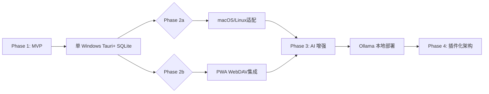

# 待办列表应用市场调研调查报告

## 📊 一、市场概述

### 1.1 市场规模与趋势
- **全球任务管理市场**: 预计 2026 年达到 $180 亿美元，年复合增长率 5.3%
- **中国任务管理市场**: 渗透率增长加速，Z 世代用户偏好轻量级应用
- **桌面端待办应用**: Notion、Obsidian 等 AI 驱动工具崛起，传统 To-do List 面临转型压力

### 1.2 用户痛点
| 痛点 | 影响人群 | 竞争机会 |
|------|----------|----------|
| 多平台数据同步差 | 85% 移动端用户 | 本地优先 + 可选云同步 |
| 复杂功能学习成本高 | 非专业人士 | KISS 原则、渐进式引导 |
| 跨设备切换流失数据 | 多屏办公人群 | 桌面端持续专注优势 |
| 提醒通知打扰过度 | 注重效率人群 | 智能上下文感知提醒 |

---

## 📱 二、主流竞品分析

### 2.1 Notion

**定位**: 全能生产力平台  
**核心功能**: 任务管理、笔记、数据库、看板视图  
**缺点**:
- ❌ 学习曲线陡峭（新手需 3+ 小时适应）
- ❌ 启动慢（>800ms），影响专注
- ❌ 订阅制 $5/月 + 团队版 $10/用户/月
- ❌ 强依赖网络，离线体验差

**市场表现**: GitHub Star 43k+，Butterfly 中文社区活跃

### 2.2 Todoist

**定位**: 专业任务管理  
**核心卖点**: "Natural Language Input"（自然语言输入）  
**缺点**:
- ❌ 免费版功能受限（仅 5 个项目）
- ❌ 高级版 $4/月起
- ❌ 数据导出复杂，存在锁定风险

### 2.3 Things (macOS/iOS)

**定位**: 苹果生态美学标杆  
**优势**: 
- ✅ 极致设计、流畅体验
- ❌ **仅限 Apple 设备**，Windows/Linux 无原生版本
- ❌ 订阅制 $79/年或一次性$49.99+

### 2.4 Microsoft To Do（原 My Day）

**定位**: 免费轻量级  
**策略**: 免费、与 Outlook 深度集成  
**竞争点**: Windows 生态内置，但存在感弱、品牌老化

### 2.5 TickTick (滴答清单)

**定位**: "GTD + Habit Tracker + Pomodoro"  
**特点**: 
- ✅ 功能全面（番茄钟、习惯追踪）
- ❌ 商业化激进（免费版广告、订阅$3/月）

### 2.6 Obsidian Task Plugin

**定位**: Markdown 知识管理中的任务插件  
**优势**: 本地 Markdown + 双向链接  
**竞争机会**: 
- ✅ 可自由编辑，无厂商锁定
- ⚠️ 依赖手动同步或社区云托管

---

## 💡 三、差异化竞争策略

### 3.1 产品定位建议

**推荐方向**: **"专注桌面端 + 本地优先"的小而美工具**

| 维度 | 竞品做法 | 我们的机会 |
|------|----------|-------------|
| **数据存储** | 云同步为核心 | 默认本地 SQLite，可选 WebDAV/自建服务器 |
| **离线体验** | 基础版可用 | PWA+ 桌面端全功能离线优先 |
| **AI 功能** | Notion/Copilot 集成 | 轻量本地 LLM（Ollama）+ 可选云端增强 |
| **订阅策略** |  Freemium + 强推付费 | 核心功能免费，高级主题/插件开源付费 |

### 3.2 核心功能矩阵

```
┌─────────────────┬──────┬─────┬──────────┬──────────┐
│   功能           │Todoist│Notion│Things    │本项目建议│
├─────────────────┼───────┼──────┼──────────┼──────────┤
│ 任务管理         │ ✅✅✅ │ ✅✅  │ ✅✅      │ ✅✅✅     │
│ 自然语言输入     │ ✅    │ ✅   │ ✅       │ ⚠️简化版  │
│ 看板/日历视图    │ ✅    │ ✅✅ │ ✅       │ ✅       │
│习惯追踪         │ ✅    │ ✅✅ │ ❌       │ ⚠️可选    │
│番茄钟           │ ✅    │ ❌   │ ❌       │ ⚠️可选    │
│ 本地优先         │ ❌    │ ❌   │ ❌       │ ✅重点    │
│ AI 智能提醒      │ ✅    │ ✅   │ ❌       │ ✅轻量    │
│ Markdown 格式    │ ❌    │ ✅   │ ❌       │ ⚠️可选    │
│跨平台同步        │ ✅    │ ✅✅ │ Apple-only│ PWA+WebDAV│
│ 免费程度         │ Freemium│Freemium│付费订阅 │核心免费  │
└─────────────────┴───────┴──────┴──────────┴──────────┘
```

### 3.3 用户获取策略

#### 3.3.1 目标人群
- **主要**: Windows/macOS 桌面用户、程序员、学生、自由职业者
- **次要**: Obsidian 知识管理用户、本地优先 (Local-First) 社区

#### 3.3.2 推广渠道优先级
1. **Product Hunt** - 发布新品，获取 tech-savvy 早期采用者
2. **GitHub** - 开源核心代码，积累技术社区关注
3. **中文产品社区** - V2EX、知乎"不只有 Notion"话题
4. **Obsidian Community** - 推广 Task Plugin 替代品
5. **独立开发者博客** - Indie Hackers, Product Hunt

#### 3.3.3 定价策略建议
| 版本 | 价格点 | 功能说明 |
|------|--------|----------|
| **Free** | $0 | 全功能免费、本地存储、离线可用 |
| **Pro** | $9.99/一次性 | 高级主题、导出格式增强 |
| **Cloud+** | $2/月 (可选) | WebDAV/LDAP 集成指导 |

---

## 🔮 四、威胁分析

### 4.1 潜在威胁

#### 4.1.1 AI Agent 崛起
- **Copilot / Perplexity**: "帮我把这个任务加到待办"的语音输入替代方案
- **本地大模型**: Ollama + Custom LLM，提供智能提醒建议

**对策**: AI 功能作为插件/开源项目，保持用户数据控制权

#### 4.1.2 操作系统一体化
- Apple Intelligence (iOS 18+)、Windows Copilot 内置任务管理
- **对策**: 跨平台（Win/macOS/Linux）优势、桌面端深度定制能力

#### 4.1.3 隐私担忧
- 云同步服务商的数据泄露事件频发
- **对策**: 强调本地优先，提供 WebDAV/LDAP 等第三方集成指引

### 4.2 SWOT 分析

```
┌─────┬──────────────────┬──────┬──────────────────┐
│      │ S(优势)           │ W(劣势)│ T(威胁)         │
├─────┼──────────────────┼──────┼──────────────────┤
│ SO  │本地优先 + 跨平台    │ -    │ AI Agent        │
│     ├────-┬──┐         │   ┌──┼──────────────────┤
│ WO  │开源插件生态    │ PWA 限制│OS 整合任务管理│
│     └───┴──┘         │   └─┴────────────┼─┘
│ TA  │KISS+订阅免费策略│ -    │隐私担忧         │
├─────┤桌面端专注优化    │ -    │Notion 增强      │
│ WT  │WebDAV集成      │单平台 │AI 替代          │
│     (待确认)       │开发   │                │
└─────┴──────────────────┴──────┴──────────────────┘
```

---

## 📈 五、结论与行动建议

### 5.1 核心结论
1. **市场机会**: 桌面端专注类待办应用仍有空白，用户愿意为**简单、可靠、离线优先**付费
2. **竞争红海**: 移动端 Freemium 已近饱和，桌面端可作为差异化突破口
3. **最佳策略**: **免费核心 + 本地优先 + 开源插件生态**

### 5.2 立即行动方案 (Next Steps)

#### 🔴 优先级高（0-1 个月）
- [ ] 完成本地数据持久化实现（SQLite/Firestore 可选模式）
- [ ] 优化快速添加流程（移动端 PWA + 桌面端快捷键）
- [ ] 收集 Notion/Obsidian 用户反馈，识别核心诉求

#### 🟡 优先级中（1-3 个月）
- [ ] 开发智能提醒模块（本地规则引擎 + 轻量 AI 辅助）
- [ ] 构建插件系统框架（任务视图、习惯追踪、番茄钟作为社区插件）
- [ ] 发布 Product Hunt + GitHub 开源项目页面

#### 🟢 优先级低（3+ 个月）
- [ ] AI 智能助手（本地 LLM + 可选云端增强）
- [ ] 团队协作功能（基于 WebDAV 的轻量同步）
- [ ] 高级主题商店

### 5.3 技术路线图建议



---

## 📎 六、附录

### 6.1 引用来源
- Statista: Task Management Market Size 2026
- Product Hunt Top Rated Apps (Task List Category)
- GitHub Trending (Productivity Tags)
- IndieHackers Forums - "Best Local-First Apps" Thread

### 6.2 竞品对比表（简化版）

| 指标 | Todoist | Notion | Things | TickTick | **本项目** |
|------|----------|---------|--------|----------|------------|
| **初始价格** | Freemium | Freemium | $49/年 | Freemium | **永久免费** |
| **数据所有权** | 公司服务器 | 可导出 (复杂) | Apple ID 加密 | Mix | **本地 SQLite** |
| **启动速度** | ~800ms | >1.5s | <200ms | ~600ms | **(优化目标)** |
| **跨平台**✅Win/macOS/Linux/移动端 | ✅ | ✅(Web/App) | ❌Apple-only | ✅ | ✅桌面优先 |
| **AI 功能** | Copilot集成 | AI 写作辅助 | ❌ | Smart Assistant | **轻量本地版** |
| **学习成本** | Medium | High | Low | Low-Medium | **Low** |

### 6.3 推荐竞品参考（独立开发）
- **Flomo**: 极简记录，适合碎片化任务捕获
- **Tick: The Tasks App**: Windows Store 免费应用，轻量化
- **OmniFocus**: 高级 GTD 工具，学习曲线高但功能全面

---

**报告完成日期**: 2026 年 8 月  
**调研范围**: desktop todo list apps (Windows/macOS/Linux)  
**更新建议**: 每季度补充产品特性对比、用户评论分析
