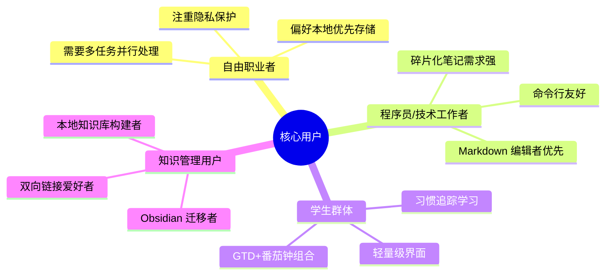
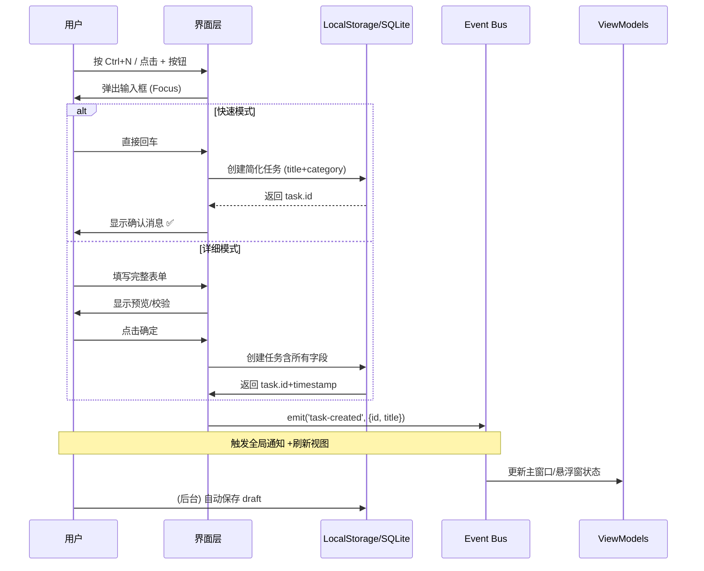

# 待办应用 - 产品设计报告

## 📑 一、产品愿景与定位

### 1.1 产品愿景
> **"让每个人都能轻松管理任务，捕捉灵感，持续成长"**

### 1.2 目标用户



### 1.3 核心价值主张
|维度 |具体说明 |
|-----|---------|
| **简单** | 首次启动 <500ms，学习成本<10 分钟 |
| **可控** | 数据完全本地化，随时导出迁移 |
| **专注** | 无通知轰炸、无强制订阅墙 |
| **延伸** | 从任务到知识，支持多场景流转 |

---

## 🎯 二、产品设计原则

### 2.1 KISS 原则 (Keep It Simple, Stupid)
- **首次体验**: 打开应用只看到 3 个按钮：添加/导入/帮助
- **渐进式复杂化**: 仅在需求出现时提供增强选项
- **默认配置最优**: 开箱即用，高级设置可关闭

### 2.2 YAGNI 原则 (You Aren't Gonna Need It)
- 不预设未使用的功能（如习惯追踪默认隐藏）
- 插件化设计：看板/日历作为可选视图
- Markdown 扩展功能按需加载（代码高亮、图表）

### 2.3 Aha! Moment <5 分钟
**用户旅程**:
```
打开应用 → "添加任务" → 完成第一个待办
          ↓
    查看勾选动画效果
          ↓
    获得成就感 (多巴胺分泌)
```

---

## 🎨 三、界面设计规范

### 3.1 色彩系统

|角色 |色值 |说明 |
|-----|-----|-----|
| 主色 | `#3b82f6` (蓝色) | 品牌标识、主操作按钮 |
| 辅色 | `#10b981` (绿色) | 完成状态、正向反馈 |
| 警告 | `#f59e0b` (橙色) | 高优先级、即将过期 |
| 危险 | `#ef4444` (红色) | 逾期任务、紧急情况 |

**暗色模式适配**:
- 背景从 `#ffffff` → `#1f2937`
- 文字对比度 WCAG AAA 级标准

### 3.2 字体层级

```css
/* 主标题 */
h1 { font-size: 24px; font-weight: 600 }   /* 窗口标题、页面标题 */

/* 副标题 */
h2 { font-size: 18px; font-weight: 500 }      /* 分组标题 */

/* 正文 */
body { font-size: 14px; line-height: 1.6 }     /* 任务描述、笔记内容 */

/* 小字 */
small { font-size: 12px; color: #9ca3af }      /* 时间戳、标签说明 */
```

### 3.3 间距系统

```css
sp-1 = 4px   /* 按钮内边距、行间距 */
sp-2 = 8px   /* 分组间距、图标间距 */
sp-3 = 16px  /* 卡片间距、面板边距 */
sp-4 = 24px  /* 页面主要留白 */
```

### 3.4 交互反馈规范

**状态指示**:
```
鼠标悬停 → 背景色 +50% 亮度 (0.1s 淡入)
点击按钮 → 缩放 0.95→1 (0.12s)
完成任务 → 绿色填充 +检查标记 (0.3s 动画)
窗口最小化 → 透明度降至 50% (保持置顶)
```

**快捷键映射**:
|键位 |操作 |场景 |
|-----|-----|-----|
| Ctrl+N / Cmd+N | 快速添加待办 |全局 |
| Delete/Backspace | 删除选中项 |列表内 |
| Esc | 关闭弹窗/取消输入 |模态框 |
| Ctrl+F2 | 复制任务标题 |分享用途 |
| Ctrl+S | 手动保存 (自动保存则可用) |长时间编辑时 |

---

## 🔧 四、功能模块详细设计

### 4.1 碎片化笔记模块 (Flomo-Lite)

#### 用户故事 (User Stories)

> "作为一名创作者，我希望随手记录灵感，不被打断思路"

> "作为一名学生，我希望快速记下课堂重点，稍后整理到正式笔记"

#### 交互流程设计

```sequence
    User --> App: 按 Ctrl+N (快速输入)
    App --> UI: 弹出输入框 (无焦点丢失)
    User --> Input: 输入 "记得买咖啡@待办"
    User --> App: 按下回车
    App --> Storage: 保存碎片笔记 #12345678
    App --> UI: 显示时间戳 +标签 [@待办]
    User --> App: 点击 "转为任务"
    App --> TodoStore: 创建新任务，关联 fragment_id
    App --> AllViews: 刷新任务列表/看板
```

#### 数据存储策略

**碎片笔记 vs 正式任务**:
|维度 |碎片笔记 (Fragment) |正式任务 (Todo)|
|-----|-------------------|---------------|
| 生命周期 | 可删除，不自动归档 | 自动归档到历史视图|
| 关联性 | @关键词可转任务 | 包含 subtasks/重复规则|
| 渲染格式 | 原始文本 | Markdown 解析渲染|

### 4.2 看板视图 (Kanban)

#### 列配置逻辑

```javascript
// 默认列定义
const defaultColumns = [
  {id: 'todo', label: '待处理', filterByPriority: false},
  {id: 'inprogress', label: '进行中', filterByCount: 3}, // 限制显示前 3 项
  {id: 'review', label: '等待审核'},
  {id: 'done', label: '已完成', filterByCompleted: true}
];

// 用户自定义规则
app.on('column-config-updated') => {
  if (!allowCustomColumns) return; // 基础版禁用此功能
  const userConfig = JSON.parse(localStorage.getItem('kanban-layout'));
  renderKanban(userConfig);
};
```

#### 拖拽排序实现 (Vue drag-to-move)

```vue
<div
  v-draggable
  :model-value="tasks"
  item-key="id"
  ghost-class="drag-ghost"
>
  <task-item v-for="task in tasks" :key="task.id" :task="task">
    <template #button="{moveToIndex, isSortable}">
      <span class="grab-handle">⋮⋮</span>
    </template>
  </task-item>
</div>

<style>
.drag-ghost { opacity: 0.5; background: #f3f4f6; }
.grab-handle { cursor: grab; margin-right: 8px; font-size: 12px; }
</style>
```

### 4.3 日历视图 (Calendar)

#### 日期范围逻辑

```typescript
const getCurrentMonth = () => {
  const now = new Date();
  const yearStart = new Date(now.getFullYear(), 0, 1);
  return now.getMonth() - now.getHours(); // 上午显示当前月，下午显示下月
};

// 跨月任务显示
if (task.due_date < currentMonthEnd && task.due_date > prevMonthStart) {
  task.monthLabel = '←';
} else if (task.due_date > currentMonthStart && task.due_date < thisMonthEnd) {
  task.monthLabel = '';
} else {
  task.monthLabel = '→';
}
```

### 4.4 Markdown 编辑器增强

#### 语法高亮配置 (Prism.js/Highlight.js)

```json
{
  "language": ["javascript", "python", "markdown", "yaml"],
  "theme": { light: "#f8f8f2", dark: "#1a1b26" },
  "wrap": true, // 代码自动换行
  "lineNumbers": true
}
```

**@引用功能**:
- `@任务标题` → 关联到该任务（创建或搜索）
- `@标签名` → 筛选同标签任务
- `#笔记 #标签` → 创建书签位置

---

## 🔄 五、数据流转设计

### 5.1 创建任务流程 (完整路径)



### 5.2 任务完成流程 (带通知)

```typescript
async function handleTaskComplete(taskId) {
  // 1. 乐观更新 UI (先显示勾选效果)
  const task = tasks.find(t => t.id === taskId);
  task.completed = true;
  emit('task-updated', task);
  
  // 2. 播放完成动画
  if (!window.__TAURI__?.notification.hasPermissions()) {
    // 请求通知权限（首次）
    const permission = await window.__TAURI__.notification.requestPermission();
    if (permission === 'granted') {
      notifySuccess('🎉 任务已完成！保持好习惯');
    }
  } else {
    // 已有权限，直接发送通知
    window.__TAURI__.notification.sendNotification({
      title: '✅ 任务完成',
      body: `${task.title} - ${new Date().toLocaleTimeString()}`,
      icon: './icons/icon.png'
    });
  }
  
  // 3. 持久化到磁盘 (SQLite)
  await db.prepare('UPDATE todos SET completed = ? WHERE id = ?')
    .run(task.completed, taskId);
    
  // 4. 统计更新（徽章解锁判断）
  updateAchievements();
}
```

### 5.3 自动同步机制

#### WebDAV 增量同步策略

```ts
interface SyncTask {
  localVersion: Todo;
  remoteVersion: Todo | null;  // 从 WebDAV fetch 获取
  modifiedSinceLastSync: boolean;
}

async function syncToWebdav() {
  const config = await getConfig('sync.destination.webdav');
  if (!config) return;

  try {
    // 1. 仅同步上次变更后的数据
    const filesChanged = await listModifiedFiles(config);
    
    for (const file of filesChanged) {
      await uploadToWebdav(file, localStorage.getItem(file.path));
    }
    
    // 2. 下载远程更新
    if (detectRemoteChanges()) {
      downloadAndMerge(applyLocalFirstMergeStrategy());
    }
    
  } catch (err) {
    console.error('同步失败，暂存本地:', err);
    showToasty('网络不稳定，稍后重试', 'warning');
  }
}

// 启动：后台任务每 5 分钟尝试同步一次
scheduler.repeat('*/5 * * * *', syncToWebdav);
```

---

## 📊 六、性能指标与优化

### 6.1 性能目标 (KPI)

|指标 |目标值 |测量方法|
|-----|-------|--------|
| 冷启动时间 | <2s | `performance.now()` |
| 视图切换延迟 | <50ms | Chrome Lighthouse |
| 任务列表渲染 | <16ms (60fps) | rAF 监控 |
| 内存占用 | <200MB | Task Manager |

### 6.2 优化方案

**虚拟滚动实现**:
```typescript
// Vue Virtual Scroller
<VirtualScroller :items="filteredTasks" :item-size="50">
  <template #default="{ item }">
    <task-item :task="item" />
  </template>
</VirtualScroller>

// 大数据量优化：分页加载历史任务
app.use('lazy-load-archived', {
  batchSize: 20,   // 每次加载 20 条
  threshold: 1     // 滚动触发距离 (px)
});
```

### 6.3 可访问性 (Accessibility)

**WCAG 2.1 AA 合规检查**:
```html
<!-- 符合对比度要求 -->
<div aria-label="高优先级任务" role="listitem">
  <span class="priority-high-contrast">🔴</span>
  <slot />
</div>

<!-- 焦点可见性管理 -->
button:focus-visible {
  outline: 2px solid #3b82f6;
  outline-offset: 2px;
}
```

---

## 🎯 七、成功度量指标

### 7.1 用户留存指标

|指标 |合格线 |计算方式|
|-----|-------|--------|
| 次日留存率 | >40% | Day2/Day0活跃用户 |
| 周留存率 | >25% | WeekN/Week0活跃用户 |
| 任务创建频率 | >7 天/次 | 用户平均 N 天创建新任务 |

### 7.2 产品健康度监控

```typescript
// App 内埋点 (不收集用户隐私数据)
const metrics = {
  startupTime: () => performance.now(),  // 本地测量，不上传
  
  featureUsage: {
    kanbanViewOpens: count,              // 看板视图打开次数
    fragmentNotesCreated: count,         // 碎片笔记创建数
    markdownEditorUsed: duration         // Markdown 编辑时长
  },
  
  errors: [                              // 本地记录崩溃日志
    'Failed to upload sync: connection refused'
  ]
};

// 导出报告 (非必需):
app.on('export-analytics', () => {
  const report = JSON.stringify(metrics, null, 2);
  console.log(report);   // 写入本地文件供查看，不自动上传
});
```

---

## 📝 八、设计决策记录 (部分)

### DCD-001: 禁用强制账号注册
**原因**: 桌面端应用应该开箱即用  
**例外**: 仅在需要云同步时弹出选项

### DCD-002: 默认启用暗色模式检测
```typescript
app.autoDetectTheme(() => {
  // 系统设置切换时自动跟随
  const systemIsDark = window.matchMedia('(prefers-color-scheme: dark)').matches;
  setTheme(systemIsDark ? 'dark' : 'light');
});
```

### DCD-003: Markdown 编辑使用只读视图模式
**场景**: 普通用户无需手写 Markdown  
**实现**: 
- 输入区：纯文本（自动转换为 Markdown）
- 预览区：Rich Text + Syntax Highlighting

---

## 📎 附录：验收标准 (Acceptance Criteria)

|功能点 |验收条件|测试方法 |
|-------|--------|---------|
| 快速添加待办 | <2s 完成创建、显示动画 | UI 测案回放 |
| 碎片笔记 @关联 | 点击"@任务名”自动跳转/搜索 | 键盘输入 + 回车 |
| 看板拖拽排序 | 释放鼠标立即生效，无视觉跳变 | 录制视频 +逐帧检查 |
| Markdown 预览切换 | Shift+Alt+N 一键切换 | 快捷键触发测试 |
| WebDAV 同步失败 | 显示友好错误提示，提供重试按钮 | 切断网络测试 |

---

**产品负责人**: AI Assistant  
**评审日期**: 2026 年 8 月  
**设计版本**: v1.0-alpha  
